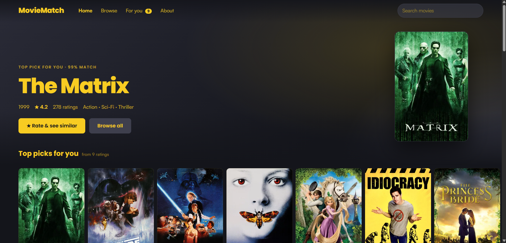
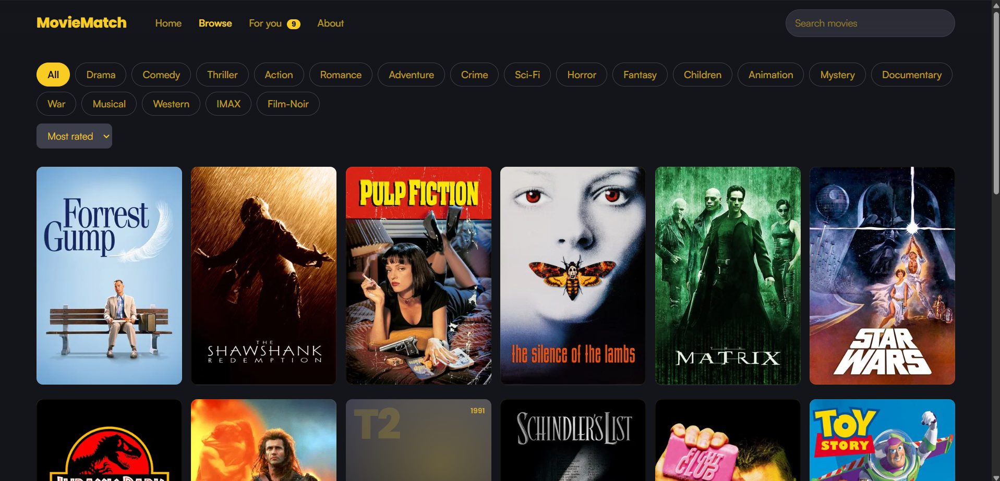
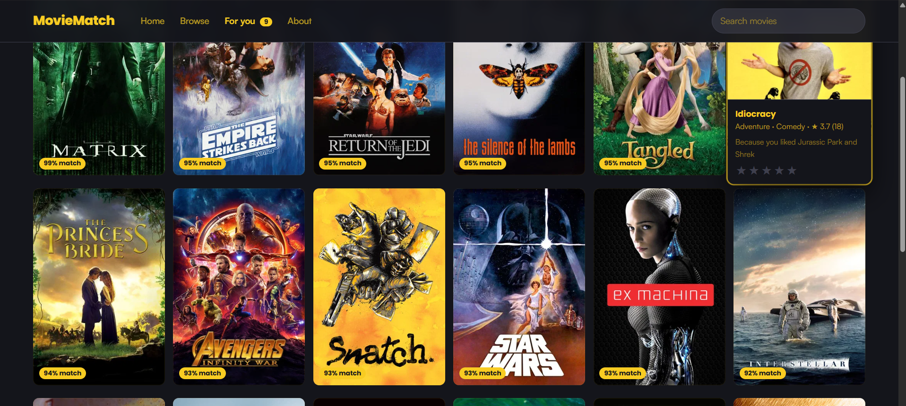
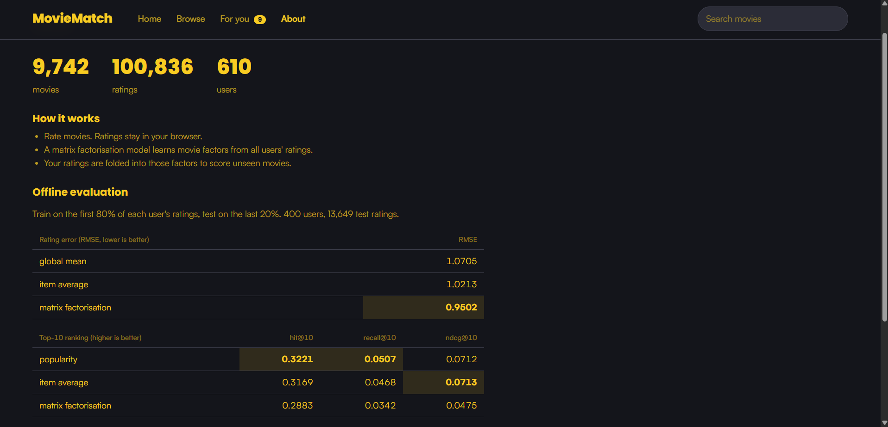

# MovieMatch

Movie recommendation systems traditionally rely on historical user ratings and preferences to generate personalised suggestions. However, user interests are dynamic and can change over time, making conventional recommendation approaches less effective in adapting to evolving preferences. This project explores the application of **Reinforcement Learning through Non-Stationary Multi-Armed Bandit algorithms** to develop an adaptive movie recommendation system.

Using the **MovieLens ML-Latest-Small dataset** from GroupLens, the system leverages movie ratings, genres, and user interactions to model recommendation decisions. Each movie or recommendation option is treated as an arm, while user feedback serves as the reward signal for the learning agent. Unlike stationary bandit approaches that assume reward distributions remain constant, non-stationary bandit learning accounts for changing user preferences by adapting its reward estimates over time. This enables the system to balance exploration and exploitation, discovering potentially relevant movies while continuously refining recommendations based on new feedback.

The application integrates a **FastAPI backend** with a web-based frontend, providing an interactive movie discovery and recommendation experience. Movie posters are retrieved using The Movie Database (TMDB) API. The project demonstrates how reinforcement learning can support personalised recommendations in dynamic environments, where user preferences are not fixed but continuously evolve.

### 1. Home -- Personalised Movie Recommendations

The home page displays the top movie recommendation based on the user's
rating history, along with personalised movie picks and match
percentages.



### 2. Browse -- Movie Discovery

Browse the movie collection, search for titles, filter by genres, and
sort movies based on ratings and popularity.



### 3. For You -- Personalised Recommendations

The recommendation page displays movies ranked according to predicted
user preferences, with match percentages and explanations based on
previously rated movies.



### 4. About -- Model Evaluation

The About page presents dataset statistics, model performance, and
offline evaluation results comparing matrix factorisation against
baseline recommendation approaches.



## Run

Use Python 3.12 to match the Docker image. PowerShell shown; on macOS/Linux use `source .venv/bin/activate`.

```powershell
# 1. environment (pick one)
py -3.12 -m venv .venv ; .\.venv\Scripts\Activate.ps1
#   or: conda create -n moviematch python=3.12 -y ; conda activate moviematch

# 2. install
pip install -r requirements-dev.txt

# 3. test (synthetic data, no download)
python -m pytest -q

# 4. data + metrics
python scripts/fetch_data.py
python -m app.evaluate

# 5. run
uvicorn app.main:app --reload          # http://127.0.0.1:8000

# 6. smoke-check the running server (second terminal)
python scripts/check.py
```

Expected: step 3 prints `20 passed`; step 6 prints `All checks passed`. Only build Docker after both.

## Docker

```powershell
docker compose up --build              # http://localhost:8000
python scripts/check.py                # same smoke-check against the container
docker compose down
```

Plain Docker: `docker build -t moviematch .` then `docker run -p 8000:8000 moviematch`.
The build downloads the dataset and computes metrics, so it needs internet access.

## Use

- **Home:** hero banner plus scrolling rows (Most rated, Top rated, Top per genre). Hover a poster to rate it.
- **Browse:** search, filter by genre, sort, open a movie for similar titles.
- **For you:** rate 5 movies (stars) to get recommendations with match % and reasons. Filter by genre. Top picks also appear on Home.
- **About:** dataset size and offline evaluation.

Ratings are stored in the browser (localStorage). No accounts.

## Posters (optional)

MovieLens has no images. With a free TMDB key the site shows real posters (`links.csv` maps each movie to its TMDB id).

```powershell
copy .env.example .env             # creates .env in the project root
notepad .env                       # change the line to: TMDB_API_KEY=your-key   (no quotes, no spaces)
uvicorn app.main:app --reload      # restart the server after editing .env
python scripts/fetch_posters.py    # optional: pre-fetch (~10 min); otherwise posters load on demand
```

- Key: create a free account at themoviedb.org, then Settings > API. Either the v3 key or the v4 read-access token works.
- Posters load on demand and are cached in `data/ml-latest-small/posters.json`. Movies without a poster keep the generated tile.
- The app and Docker Compose both read `TMDB_API_KEY` from `.env`; a real environment variable overrides it. `.env` is git-ignored: never commit it. On Render set it under Environment.
- TMDB requires the credit line shown in the footer and About page: "This product uses the TMDB API but is not endorsed or certified by TMDB." TMDB also asks for its logo in credits; see themoviedb.org/about/logos-attribution.
- Poster images are loaded by the browser directly from TMDB's CDN.

## How it works

- Biased matrix factorisation (ALS, 32 factors) trained at startup on all MovieLens ratings.
- Your ratings are folded in as a new user by ridge regression on the movie factors.
- Movies with fewer than 10 ratings are not recommended.
- Similar movies: cosine similarity of movie factors.

## Evaluation

`python -m app.evaluate`: train on the first 80% of each user's ratings (by time), test on the last 20%.
Reports RMSE and hit/recall/NDCG@10 against global-mean, item-average and popularity baselines.
Results are written to `data/ml-latest-small/metrics.json` and shown on the About tab.
Check the printed numbers: matrix factorisation is expected to win on RMSE; popularity can win on top-10 ranking.

## Test

```bash
python -m pytest -q
```

Tests run on a synthetic MovieLens-format dataset (no download needed). They cover loading, title parsing, the model, the temporal split and every API endpoint.

## Structure

```
app/
  main.py       API + static hosting
  data.py       MovieLens loader
  model.py      ALS recommender
  evaluate.py   offline evaluation
  posters.py    TMDB poster lookup + cache
  static/       index.html, app.js, style.css
scripts/
  fetch_data.py  download MovieLens
  check.py       smoke-check a running server
  fetch_posters.py  pre-fetch TMDB posters
tests/
Dockerfile, docker-compose.yml, render.yaml, .github/workflows/ci.yml
```

## API

| method | path | |
|---|---|---|
| GET | `/api/movies?q=&genre=&sort=&limit=&offset=` | list / search |
| GET | `/api/movies/{id}` | detail + similar |
| GET | `/api/onboarding` | movies to rate first |
| POST | `/api/recommend` `{ratings:{id:stars}, limit, genre}` | recommendations |
| GET | `/api/meta`, `/api/metrics`, `/health` | |

## Dataset

Source: GroupLens, https://grouplens.org/datasets/movielens/latest/ (`ml-latest-small`, 100k ratings).
The data is not stored in this repo (the MovieLens licence forbids redistribution). `scripts/fetch_data.py` downloads it locally; the Dockerfile downloads it at build time.
Larger option: `ml-latest` from the same page (slower startup).

## Deploy from GitHub

1. Create a GitHub repo and push this folder to `main`. `.github/workflows/ci.yml` then runs the tests and builds the Docker image on every push.
2. Host the container from the repo (GitHub Pages cannot run Python):
   - **Render:** New > Blueprint > select the repo. `render.yaml` is picked up; every push to `main` redeploys.
   - **Fly.io / Google Cloud Run:** deploy from the Dockerfile.

Reads `$PORT`. State is in memory and per user in the browser, so no database is needed.

Data: F. Maxwell Harper and Joseph A. Konstan. 2015. The MovieLens Datasets: History and Context. ACM TiiS 5(4).
